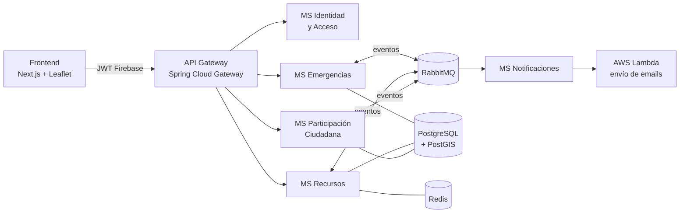
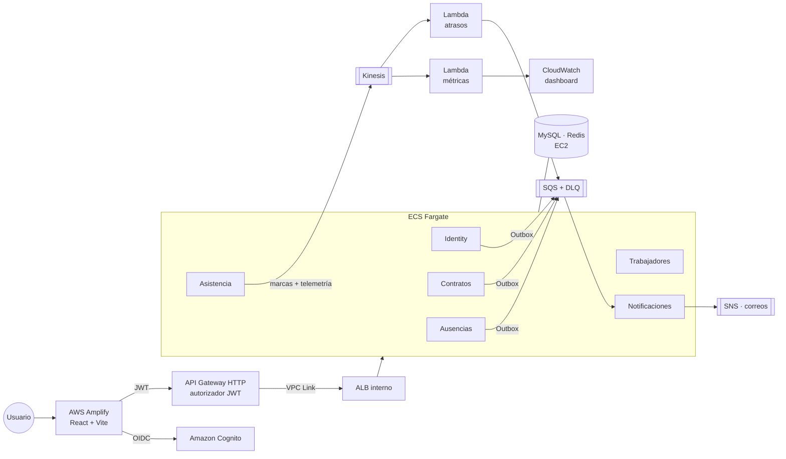

# Hola, soy Alfonso González Schlack

### Full Stack Developer | Cloud Developer

---

## 🧑‍💻 Sobre mí

Soy **Analista Programador titulado** y actualmente estudio **Ingeniería en Informática**. Me muevo con comodidad en todo el stack, aunque donde más disfruto trabajar es en el **backend**: construyo APIs y microservicios con **Java y Spring Boot**, y también con **Python y FastAPI**.

En el frontend trabajo con **JavaScript y TypeScript**, desarrollando interfaces en **React + Vite**, y uso **Node.js** dentro del ecosistema JavaScript. Para persistencia de datos tengo experiencia con bases relacionales como **PostgreSQL** y **MySQL**, y con bases NoSQL como **MongoDB**.

Mi otro foco es la **nube**: tengo amplia experiencia integrando servicios de **AWS** y llevando las aplicaciones a producción con **infraestructura como código usando Terraform**, apostando por despliegues reproducibles, escalables y fáciles de mantener.

- 📍 Viña del Mar, Chile
- 🌎 Inglés fluido
- 🌱 Actualmente profundizando en arquitecturas de microservicios orientadas a eventos en AWS

---

## 🛠️ Stack Tecnológico

**Backend**

  

**Frontend**

  

**Bases de datos y mensajería**

  

**Cloud y DevOps**

  

**Herramientas**

  

---

## 🚀 Proyectos destacados

### 🌋 CatástrofesCL — Plataforma de gestión de recursos para catástrofes

Centro de comando digital para coordinar en tiempo real la gestión de recursos humanitarios durante catástrofes naturales en Chile (terremotos, incendios, inundaciones, aluviones). Conecta organismos oficiales —SENAPRED, municipios, ONGs, bomberos— con ciudadanos que quieren ayudar, coordinando inventarios de centros de acopio, transferencias logísticas y donaciones guiadas.

**Arquitectura:** microservicios en Spring Boot que se comunican de forma asíncrona a través de RabbitMQ, con un API Gateway propio que valida los tokens de Firebase y aplica control de acceso por roles (RBAC con 5 perfiles). Los datos geoespaciales se guardan en PostgreSQL + PostGIS, Redis se usa como caché, y el envío de correos se delega a una función AWS Lambda. Todo corre en contenedores Docker pensados para orquestarse en Amazon EKS.

| Repositorio | Descripción |
|---|---|
| [**ms-emergencies**](https://github.com/Fvgaviolenta/ms-emergencies) | Ciclo de vida de las emergencias (declaración, cambios de estado) y anuncios críticos. Publica eventos de dominio como `emergency.created` a RabbitMQ. |
| [**ms-resources**](https://github.com/Fvgaviolenta/ms-resources) | Operación de centros de acopio: inventario, movimientos de stock, cálculo automático de criticidad, detección de sobrestock y sugerencias de redistribución. Expone los centros como GeoJSON para el mapa y reacciona a eventos de emergencias. |
| [MS-Api-Gateway](https://github.com/Kamilo14/MS-Api-Gateway) | Puerta de entrada única: enrutamiento y validación de tokens Firebase. *(trabajo en equipo)* |
| [MS-Notificacion](https://github.com/Kamilo14/MS-Notificacion) | Notificaciones in-app, push y email ante eventos de dominio, con una Lambda para los correos. *(trabajo en equipo)* |
| [ms-participacionCiudadana](https://github.com/gabihuenchu/ms-participacionCiudadana) | Necesidades públicas y donaciones ciudadanas. *(trabajo en equipo)* |
| [frontend-info](https://github.com/gabihuenchu/frontend-info) | Dashboard en Next.js + TypeScript con mapas interactivos y notificaciones en tiempo real vía WebSocket. *(trabajo en equipo)* |

**Tecnologías:** Java 21 · Spring Boot 3 · Spring Security · Spring AMQP · PostgreSQL + PostGIS · Flyway · Redis · RabbitMQ · Firebase Auth · AWS Lambda · Docker · Next.js · TypeScript

---

### 👥 RRHH — Plataforma multi-tenant de Recursos Humanos

Sistema SaaS de gestión de recursos humanos pensado para atender a varias empresas desde una misma plataforma (multi-tenant). Cubre la gestión de trabajadores, departamentos y cargos, contratos y liquidaciones, control de asistencia, solicitudes de ausencia y notificaciones. Los contratos se generan automáticamente a partir de plantillas Word (`.docx`) con campos que completan RR.HH. y el propio trabajador.

**Arquitectura de la aplicación:** seis microservicios Spring Boot autenticados con **Amazon Cognito** (login con email o Google). Cada servicio aísla los datos por empresa leyendo el `tenant_id` desde los claims del JWT. La comunicación entre servicios es orientada a eventos con el **patrón Outbox**: los eventos se publican en **Amazon SQS** y el servicio de notificaciones los consume y envía correos con **Amazon SNS**. Las marcas de asistencia y la telemetría de la API se transmiten en tiempo real por **Amazon Kinesis**.

**Infraestructura como código:** toda la plataforma se despliega en AWS con **Terraform**. El frontend se sirve desde **AWS Amplify** y entra por un **API Gateway HTTP** con autorizador JWT de Cognito, que llega por **VPC Link** a un **ALB interno** con 21 reglas de enrutamiento hacia los servicios en **ECS Fargate**. Las imágenes se publican en **ECR** con **GitHub Actions**. Además, dos **Lambdas en Python** procesan los streams de Kinesis: una calcula métricas y la otra detecta atrasos en las marcas de entrada. Todo se monitorea en un **dashboard de CloudWatch**, las colas tienen DLQ y la infraestructura tiene pruebas con `terraform test`.

| Repositorio | Descripción |
|---|---|
| [**rrhh-infra**](https://github.com/Fvgaviolenta/rrhh-infra) | Infraestructura completa en Terraform: red y security groups, ECS Fargate, ALB, API Gateway, Cognito, Amplify, SQS, SNS, Kinesis, Lambdas, CloudWatch y CI/CD a ECR con GitHub Actions. |
| [**rrhh-gateway**](https://github.com/Fvgaviolenta/rrhh-gateway) | BFF / API Gateway con validación de JWT de Cognito, CORS y enrutamiento a los microservicios. |
| [**rrhh-ms-identity**](https://github.com/Fvgaviolenta/rrhh-ms-identity) | Identidad, usuarios, tenants y control de acceso por roles, integrado con Cognito. |
| [**rrhh-ms-trabajadores**](https://github.com/Fvgaviolenta/rrhh-ms-trabajadores) | Ficha de trabajadores, departamentos y cargos. |
| [**rrhh-ms-contratos**](https://github.com/Fvgaviolenta/rrhh-ms-contratos) | Contratos y liquidaciones, con generación de documentos desde plantillas `.docx`. |
| [**rrhh-ms-asistencia**](https://github.com/Fvgaviolenta/rrhh-ms-asistencia) | Registro de marcas de asistencia, streaming de eventos y telemetría a Kinesis. |
| [**rrhh-ms-ausencias**](https://github.com/Fvgaviolenta/rrhh-ms-ausencias) | Solicitudes y aprobación de ausencias (vacaciones, permisos, licencias). |
| [**rrhh-ms-notifications**](https://github.com/Fvgaviolenta/rrhh-ms-notifications) | Consume eventos desde SQS y envía notificaciones a través de SNS. |
| [RRHH-Frontend](https://github.com/Kamilo14/RRHH-Frontend) | SPA en React 19 + Vite + TypeScript con login OIDC sobre Cognito. *(trabajo en equipo)* |

**Tecnologías:** Java 21 · Spring Boot 3 · Spring Cloud Gateway · Spring Security (OAuth2 Resource Server) · MySQL · Flyway · Redis · React · TypeScript · Terraform · ECS Fargate · ALB · API Gateway · Cognito · Amplify · SQS · SNS · Kinesis · Lambda (Python) · CloudWatch · ECR · GitHub Actions · Docker

---

## 📊 Estadísticas en GitHub

